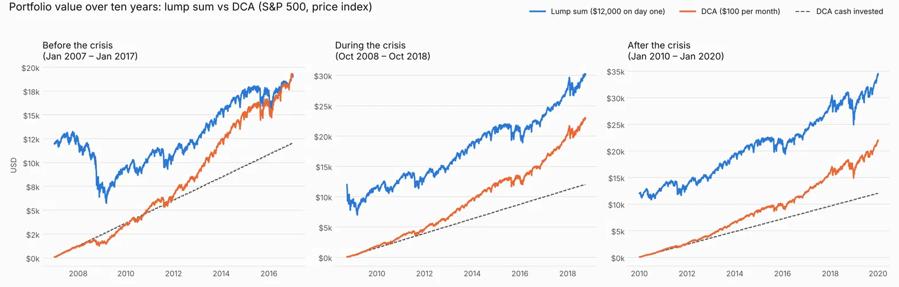
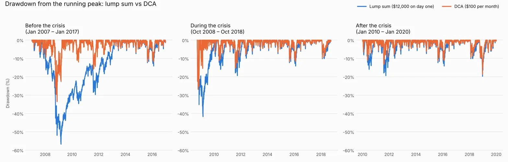

# Lump Sum vs Monthly DCA on the S&P 500

Is it better to invest $12,000 all at once or $100 a month for 10 years? This project compares the two strategies on the S&P 500 in three historical windows, before, during and after the 2008 financial crisis, using SQL (PostgreSQL).

**Short answer:** in these three windows the lump sum gave the same or a higher final value than the DCA, with deeper temporary losses.

## Business question

People who want to start investing often wait for the "right moment", or wonder whether it is better to invest everything at once (lump sum) or gradually with a monthly plan (DCA, dollar-cost averaging). This study looks at what the data say in three different moments.

| | Lump sum | Monthly DCA |
|---|---|---|
| Amount | $12,000 in one purchase | $100 a month, 120 purchases, $12,000 in total |
| Purchase date | First trading day of the start month | First trading day of each month |
| Duration | 10 years | 10 years |

Assumptions: purchases at the closing price, amounts in US dollars, no interest on the money not yet invested in the DCA, no dividends (price index), no fees or taxes.

| Scenario | Start | Valuation date |
|---|---|---|
| Before the crisis | 2007-01-03 | 2017-01-03 |
| During the crisis | 2008-10-01 | 2018-10-01 |
| After the crisis | 2010-01-04 | 2020-01-02 |

The market peak was on 2007-10-09 (1,565.15) and the low on 2009-03-09 (676.53), a fall of about 56.8%.

## Data and how to reproduce

Daily S&P 500 prices (^GSPC) come from Yahoo Finance (7,537 rows, 1996-11-18 to 2026-11-09). The raw data is not included in this repository because of Yahoo's terms of use. Only the close is used.

To reproduce the analysis: download the ^GSPC history from Yahoo Finance, load it in PostgreSQL in a table called `sp500` (date, open, high, low, close), then run `queries.sql` in order.

## Method

1. **Data checks.** No duplicates, nulls or zeros. One anomaly on 2025-09-25: the Low is above the Close; the Close matches the FRED series SP500, so only the Close is used.
2. **Closed-market days.** The table had 9 rows on days when the US market was closed, filled with the previous close. They were removed in a clean table (`sp500_clean`, 7,528 rows); the raw table was not modified.
3. **Purchase dates.** First trading day of each month, with a window that gives exactly 120 purchases. The first trading day of the valuation month is not a purchase: it is the date on which the final value is calculated.
4. **Lump sum.** Units = 12,000 / close of the purchase date. Final value = units x close of the valuation date.
5. **DCA.** Each month 100 / close of the purchase day, added up with a running total. Final value = total units x close of the valuation date. Units are kept at full precision and rounded only at the end.
6. **Total return and ROI.** Final value minus $12,000, and that divided by $12,000.
7. **Maximum drawdown.** For each day, value / highest value reached so far - 1; the maximum drawdown is the lowest value. Computed with a window function (`MAX() OVER (ORDER BY date)`).

Each result was checked by rebuilding the invested amount (final value minus total return must give $12,000) and, for the DCA units, with an independent recomputation.

## Results

| | Before (Jan 2007) | During (Oct 2008) | After (Jan 2010) |
|---|---|---|---|
| Final value, lump sum | $19,125.64 | $30,226.76 | $34,505.34 |
| Final value, DCA | $19,210.70 | $22,959.27 | $22,015.38 |
| ROI, lump sum | 59.38% | 151.89% | 187.54% |
| ROI, DCA | 60.09% | 91.33% | 83.46% |
| Max drawdown, lump sum | -56.78% | -41.73% | -19.78% |
| Max drawdown, DCA | -33.56% | -26.88% | -18.71% |

Average purchase price of the DCA, compared with the single price paid by the lump sum:

| | Before | During | After |
|---|---|---|---|
| Lump sum price | 1,416.63 | 1,161.06 | 1,132.99 |
| DCA average price | 1,410.35 | 1,528.58 | 1,775.78 |
| Difference | -0.44% | +31.7% | +56.7% |

## Conclusions

- **Final value.** The lump sum beat the DCA in 2 of 3 scenarios. In the first one the difference is $85 on about $19,000, so it can be counted as a draw.
- **Why.** When the market trends upward after the starting date, the DCA buys most of its units at higher prices than the lump sum paid on day one. In scenarios 2 and 3 its average price is 32% and 57% higher. In scenario 1 the 2008 crash pulled the DCA purchases back down, so the two prices, and the final values, are almost equal.
- **Drawdown.** The lump sum drawdown is deeper in every scenario. The two figures are not directly comparable: the DCA percentage is computed on a portfolio that grows through deposits, and in scenario 2 its minimum comes in the first month, when only $100 was invested (about $27 of loss).
- **What the data say.** In these three windows, investing everything at once gave a higher final value in two cases and the same in one, at the cost of larger temporary losses.

## Limitations

- Three windows and a single crisis: this describes what happened, not a rule for the future.
- The ends of the windows matter (scenario 2 ends just before the fall of late 2018, scenario 3 just before Covid).
- The lump sum has the full $12,000 invested for the whole period; the DCA has on average about half of it invested. The comparison assumes the $12,000 is available on day one.
- Price index: no dividends, fees, taxes or interest on the cash waiting to be invested.
- Yahoo data are not an official source; the Low of 2025-09-25 and the Open, High and Low of 2012-11-30 and 2012-12-31 are unreliable (only the Close is used).

## Files

- `queries.sql`: all the SQL queries (data checks, clean table, purchases, results, drawdown, daily views)
- `portfolio_value.webp`, `max_drawdown.webp`: charts
